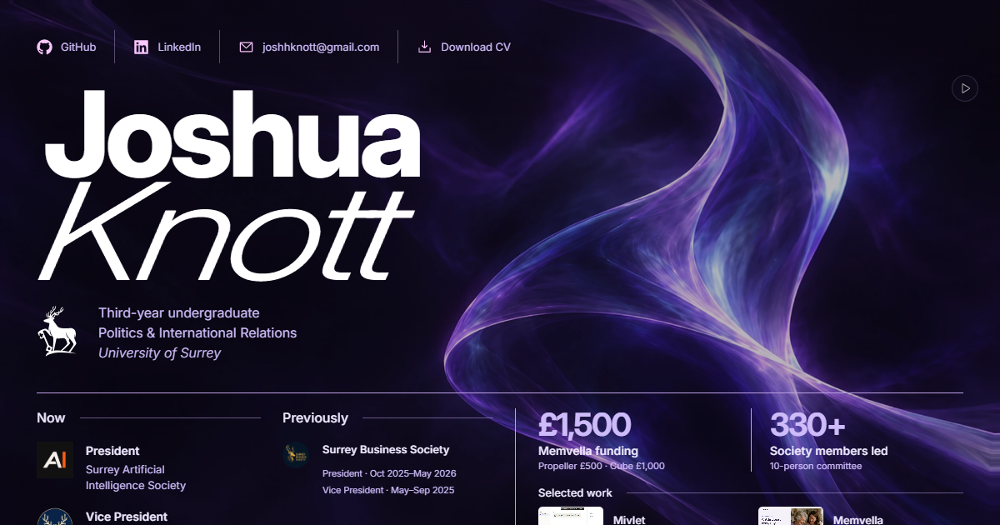
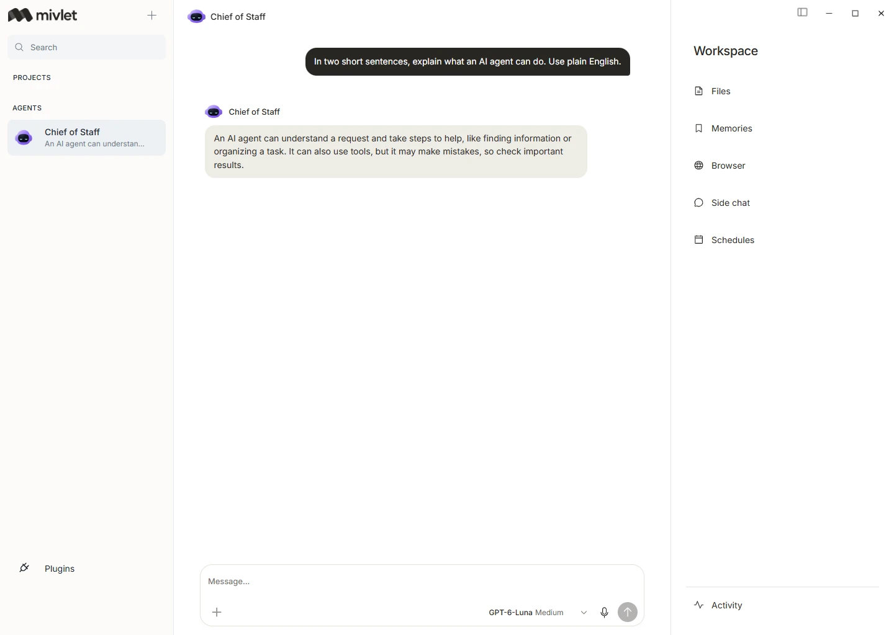
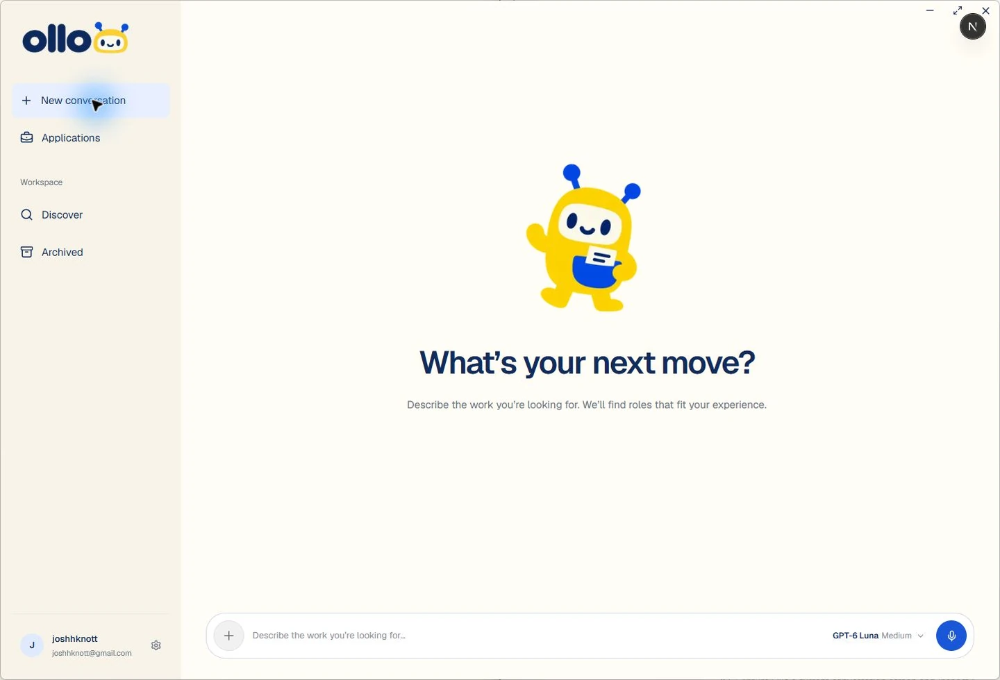
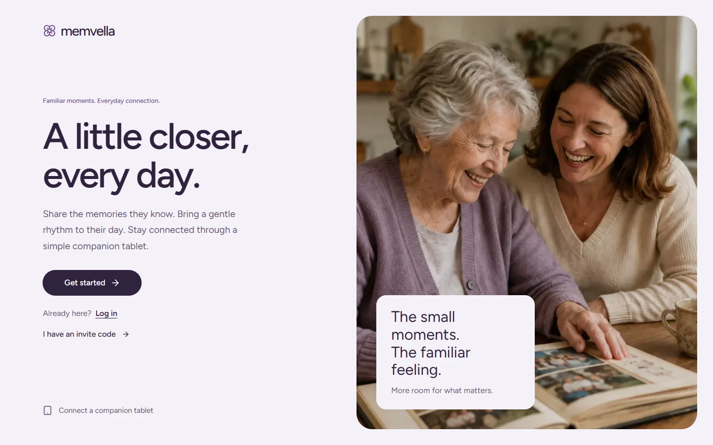
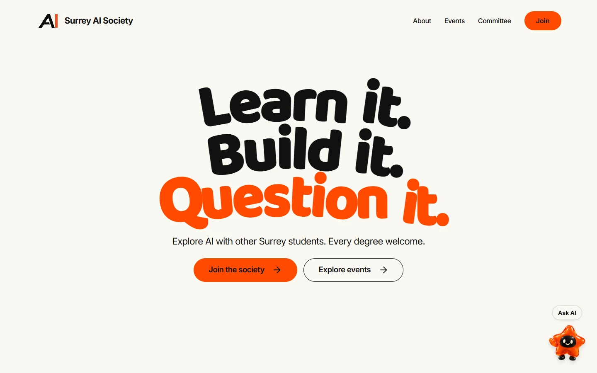
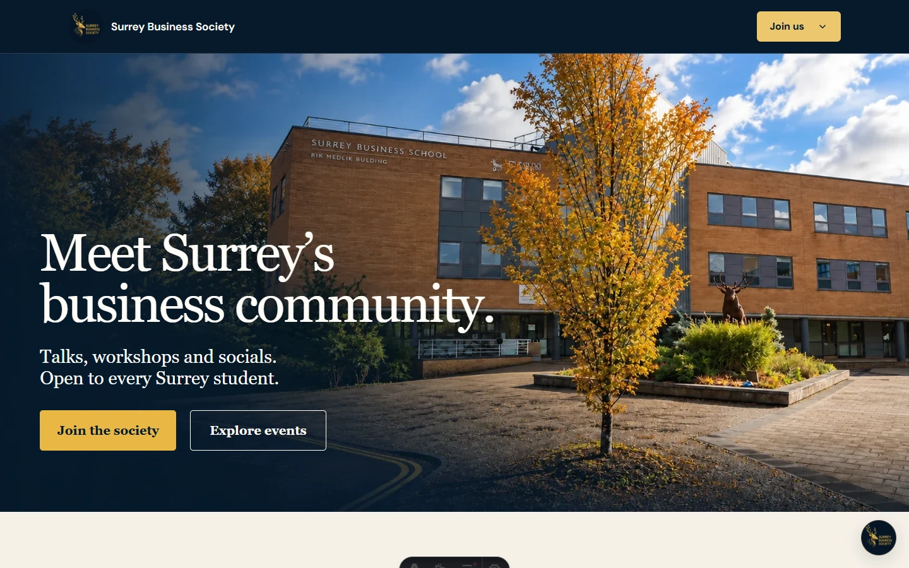
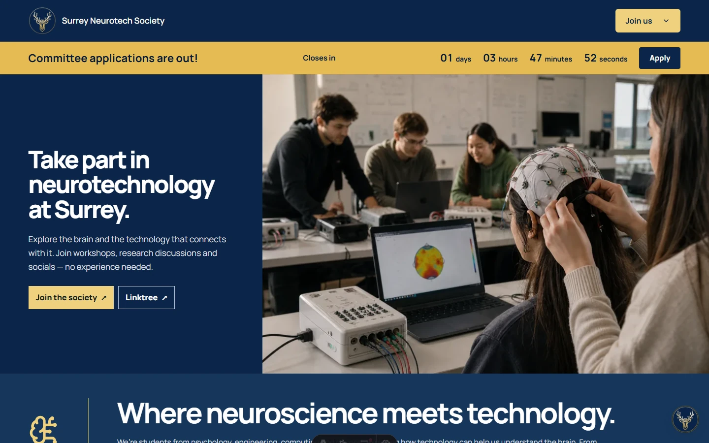

<p align="center">
  
</p>

<h1 align="center">Joshua Knott</h1>

<p align="center">
  Politics student · software builder<br />
  <a href="https://joshuaknott.tech">joshuaknott.tech</a>
  ·
  <a href="https://github.com/joshuasknott">GitHub</a>
  ·
  <a href="mailto:joshhknott@gmail.com">Email</a>
</p>

<p align="center">
  
</p>

I study Politics and International Relations at Surrey. I’m President of the AI Society, Vice President of Neurotech, and I build products I’d actually use.

---

## Mivlet

<p align="center">
  
</p>

One place for your AI agents — local-first, provider-neutral.

<p align="center">
  
</p>

## ollo

<p align="center">
  
</p>

Your next role, with a little help — private Windows job-search workspace.

<p align="center">
  
</p>

## Memvella

<p align="center">
  
</p>

Memory support that doesn’t feel clinical. Founded for early-stage memory loss and the people around them. [memvella.me](https://memvella.me) · £1,500 from Surrey’s Innovation and Enterprise Hub.

<p align="center">
  
</p>

## Surrey Societies

Three society sites — AI, Business, Neurotech — with shared infrastructure and distinct identities.

|                                            AI                                            |                                               Business                                               |                                               Neurotech                                                |
| :--------------------------------------------------------------------------------------: | :--------------------------------------------------------------------------------------------------: | :----------------------------------------------------------------------------------------------------: |
|  |  |  |

The portfolio includes 15 projects and 11 walkthroughs recorded from current local source on 6 October 2026. Every project cover and name opens a larger screen-only modal with its recording or screenshot and one available website/source link. The AI Society cover was captured from the fully loaded public homepage on the same date. The native and browser clips show actual interactions. Recording evidence and configuration limits are documented in the walkthrough review. Memvella’s family workspace is omitted while email verification remains unresolved.

Projects sit on a compact canvas with names and logos beneath each cover. Walkthroughs play inline on hover or keyboard focus. Clicking or tapping a cover or project name opens a large modal: recordings autoplay muted on repeat, without player controls, headings or descriptions. A small View link opens the project website or source when available. Videos load on demand; hover previews pause offscreen, and modal playback stops when closed. Reduced motion keeps hover previews still. [Walkthrough review and next fixes](docs/walkthroughs.md).

---

### This repo

Static site for **joshuaknott.tech** — `index.html`, `styles.css`, `main.js`, `assets/`, `data/`. No build step.

```bash
python3 -m http.server 8080
node --check main.js
```

Open to internships and collaborations — [joshhknott@gmail.com](mailto:joshhknott@gmail.com).
