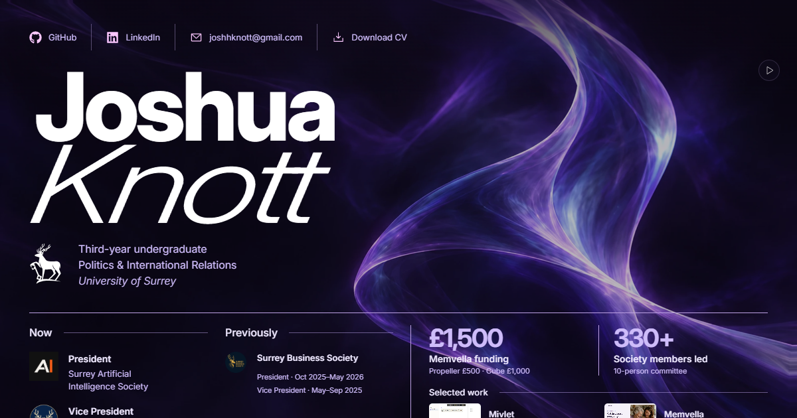
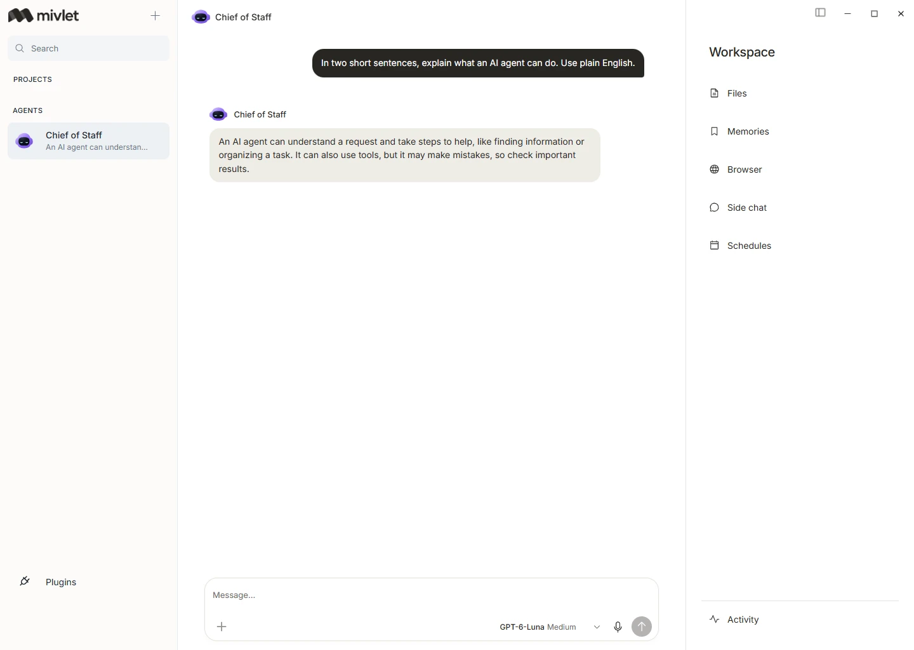
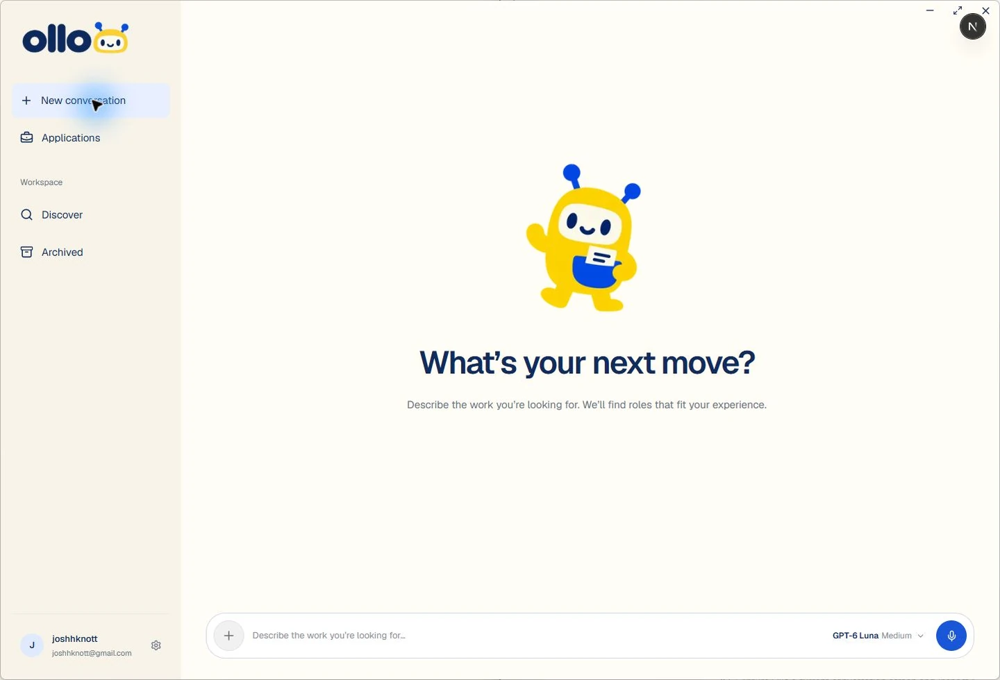
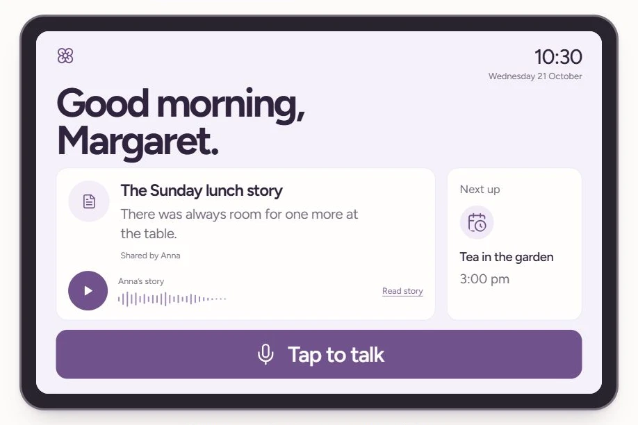
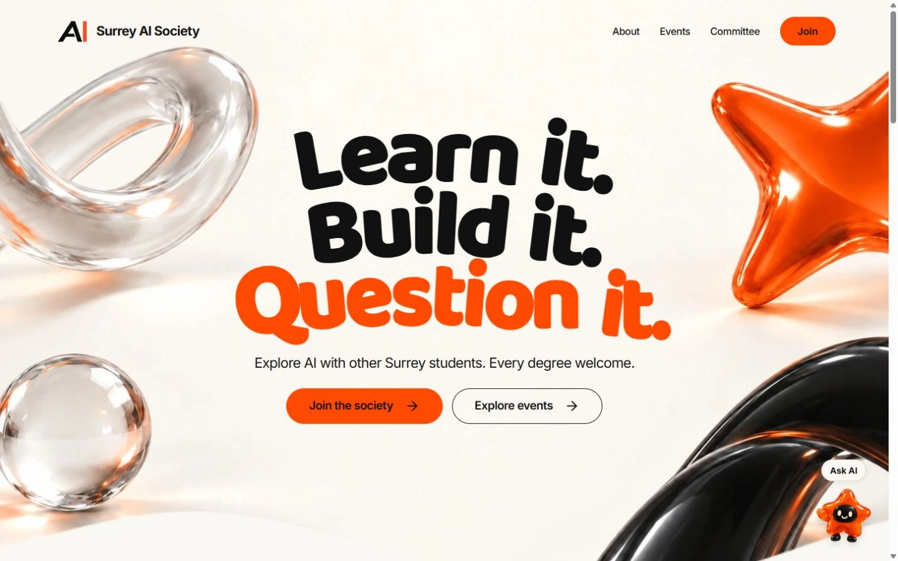
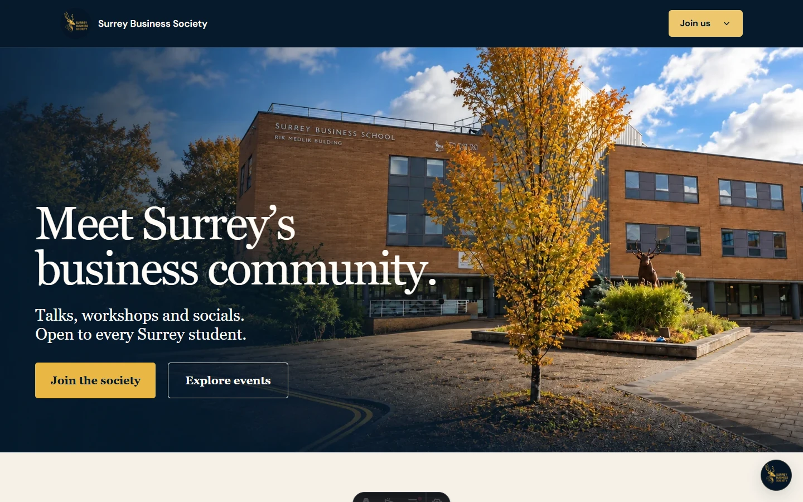
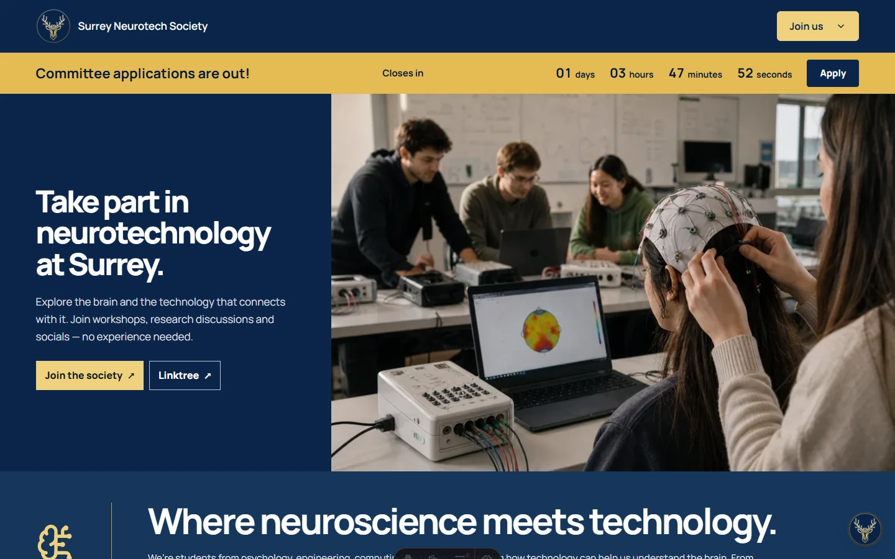

<p align="center">
  
</p>

<h1 align="center">Joshua Knott</h1>

<p align="center">
  Politics student · software builder<br />
  <a href="https://joshuaknott.tech">joshuaknott.tech</a>
  ·
  <a href="https://github.com/joshuasknott">GitHub</a>
  ·
  <a href="mailto:joshhknott@gmail.com">Email</a>
</p>

<p align="center">
  
</p>

I study Politics and International Relations at Surrey. I’m President of the AI Society, Vice President of Neurotech, and I build products I’d actually use.

---

## Mivlet

<p align="center">
  
</p>

One place for your AI agents — local-first, provider-neutral.

<p align="center">
  
</p>

## ollo

<p align="center">
  
</p>

Your next role, with a little help — private Windows job-search workspace.

<p align="center">
  
</p>

## Memvella

<p align="center">
  
</p>

Memory support that doesn’t feel clinical. Founded for early-stage memory loss and the people around them. [memvella.me](https://memvella.me) · £1,500 from Surrey’s Innovation and Enterprise Hub.

<p align="center">
  
</p>

## Surrey Societies

Three society sites — AI, Business, Neurotech — with shared infrastructure and distinct identities.

|                                            AI                                            |                                               Business                                               |                                               Neurotech                                                |
| :--------------------------------------------------------------------------------------: | :--------------------------------------------------------------------------------------------------: | :----------------------------------------------------------------------------------------------------: |
|  |  |  |

The portfolio has 15 cards grouped into products, websites and experiments. Eleven have video walkthroughs; Memvella and the three society sites use still covers.

On devices with a fine hover pointer, video covers play muted previews on mouse hover or keyboard focus on the cover, unless reduced motion is enabled. Opening a cover or project name shows a larger recording or still in a dialog. Recordings loop muted without player controls, and the cover image appears if playback fails. Project links appear where configured. See the [walkthrough guide and capture review](docs/walkthroughs.md).

---

### This repo

Static site for **joshuaknott.tech**, published from the root of `main` with GitHub Pages. No package install or build step is needed. To preview locally, run this from the repository root and open `http://localhost:8080/`:

```bash
python3 -m http.server 8080
```

| Path | Purpose |
| --- | --- |
| `index.html`, `styles.css`, `main.js` | Portfolio markup, styles and browser interactions. Project cards, no-script fallbacks and the `project-data` JSON live in the HTML. |
| `assets/` | Site artwork, brand marks, project media and the CV PDF and preview image. |
| `games/poppycheese/` | Bundled browser game. Open `/games/poppycheese/` on the local server to play. |
| `worker/index.js`, `404.html` | The asset-serving worker returns the custom page for missing files and keeps the 404 status. The Python server does not run the worker. |
| `data/stats.json`, `.github/workflows/update-stats.yml` | GitHub Actions generates the activity snapshot and updates the sitemap's last-modified date on pushes to `main`, every six hours, or on manual runs. |

The browser reads both the served activity snapshot and the raw copy from GitHub's `main` branch, keeping the newest usable result. The portfolio still works if neither snapshot loads.

Run the repository checks with Node.js:

```bash
node --check main.js
node --check worker/index.js
node --test .github/scripts/*.test.js
```

Open to internships and collaborations — [joshhknott@gmail.com](mailto:joshhknott@gmail.com).
